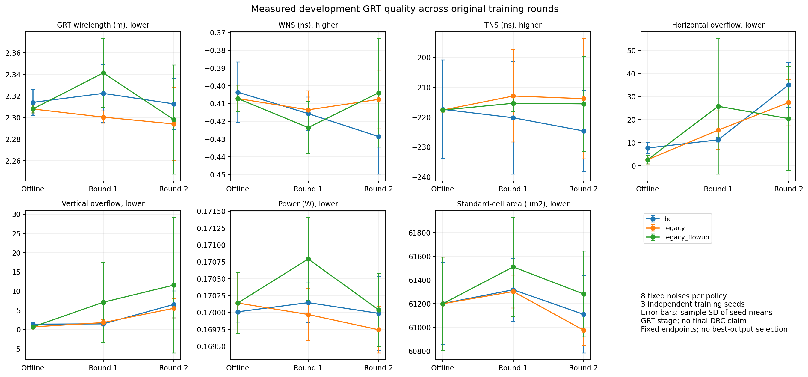

# Matched offline-to-online development results

The full declared GRT comparison has completed. Frozen-flow FQL has a small
mean advantage over matched BC after two measured-feedback rounds, but neither
FQL branch meets the prospectively declared stable-improvement rule. Final
development detailed routing has also completed without meeting its WL gate.
The original648-GRT/48-DRT compact native proof has been preserved and verified;
fresh confirmation and the user-expanded reward program, including its durable
model/native archive, remain pending. This is development evidence on `bp_fe`,
not completion of the paused FlowPlace Table2 reproduction.

## What was compared

All three independent training seeds0,1,2 start from their matched common
initialization. Round0 adds1000 actor updates. Round0 and round1 each export8
collection layouts per policy/seed; rounds1 and2 respectively consume those
measured feedback sets and each add600 updates. Round2 only exports evaluation
layouts. The final actor therefore
has2200 updates in this study, **excluding** the shared800-update actor warmup;
the shared300-update flow warmup is also a separate cost. Every round is
evaluated on the same eight saved development-noise arrays, without putting
evaluation labels into replay.

Initial Q labels come from measured TRAIN layouts, not benchmark-supplied
PPA answers. A behavior flow can generate additional layouts for the same
backend-labeling path without being retrained; the completed
[data-source contrast](qstudy_source_results.md) tests that option separately.

| Arm | Actor objective | Critic/teacher continuation | Feedback budget per seed by round2 |
| --- | --- | --- | --- |
| Matched BC |10×teacher-coordinate MSE; Q weight0 | Both frozen |16 measured layouts, unused for training |
| Frozen-flow FQL |10×teacher-coordinate MSE − Q | Critic updated; teacher frozen |16 own measured layouts added to replay |
| Updated-flow FQL | Same actor objective | Critic and teacher updated |16 own measured layouts added to replay |

The updated branch imports the exact completed frozen-FQL round0 prefix,
including optimizer/RNG state. Its48 round0 native requests are inherited
references, not48 new physical calls. It adds1200 teacher updates during
online continuation. Its comparison with frozen BC/FQL describes the total
adaptive procedure, including changed teacher and replay; it does not isolate
a Q-only or teacher-only causal effect. Equal collection budgets do not imply
equal training compute. The main frozen BC/FQL control checks pass for all
three seeds and rounds.

These are terminal whole-layout contextual-bandit updates with measured
feedback, rather than a long-horizon Bellman experiment. A policy emits one
complete layout; it is not the stepwise macro-placement policy used in PPO
placers. Current behavior flow takes10 integration steps, whereas the separate
released FlowPlace reference uses its20-step hard-constraint sampler.

## All seven GRT metrics

Each entry is the equally weighted mean of three training-seed means; each
seed mean includes all eight predeclared outputs. `±` below is the sample SD
of the three seed means for WL. Full SDs for all seven metrics, individual
requests and paired differences remain in the immutable JSON/CSV reports.
WL is converted from native µm to m. Signed WNS/TNS are ns; less negative is
better. Overflow columns retain native sum units. GRT does not measure final
DRC, and no final-route congestion is inferred from these values.

The [underlying curve data](../analysis/artifacts/qstudy_development_online_v1/curves.csv)
and [per-seed values](../analysis/artifacts/qstudy_development_online_v1/per_seed.csv)
are copied from completed read-only render1797689 with SHA-verified provenance.

| Method | Round | rWL(m)↓ | WNS(ns)↑ | TNS(ns)↑ | H overflow↓ | V overflow↓ | Power(W)↓ | Cell area(µm²)↓ |
| --- | --- | --- | --- | --- | --- | --- | --- | --- |
| BC |0 |2.314028±.012141 |−.403605 |−217.399 |7.667 |1.375 |.170010 |61200.24 |
| BC |1 |2.322383±.026714 |−.415692 |−220.214 |11.208 |1.458 |.170145 |61317.44 |
| BC |2 |2.312632±.023697 |−.428621 |−224.647 |35.083 |6.500 |.169987 |61108.98 |
| Frozen FQL |0 |2.307890±.003804 |−.407202 |−217.652 |2.625 |.667 |.170140 |61198.83 |
| Frozen FQL |1 |2.300366±.005708 |−.413557 |−212.942 |15.417 |1.792 |.169970 |61302.47 |
| Frozen FQL |2 |2.294036±.033791 |−.407682 |−213.833 |27.375 |5.500 |.169744 |60975.11 |
| Updated FQL |0, inherited |2.307890±.003804 |−.407202 |−217.652 |2.625 |.667 |.170140 |61198.83 |
| Updated FQL |1 |2.341368±.031897 |−.423541 |−215.375 |25.750 |7.083 |.170793 |61510.90 |
| Updated FQL |2 |2.298117±.050592 |−.403953 |−215.564 |20.417 |11.542 |.170038 |61281.28 |

The matched-only report verified all240 native outcomes across18 original
arm/seed/round streams. The three-arm report verified360 outcome
representations across27 streams, including the48 inherited updated-round0
references. These representation counts are not the total unique physical
call budget: the final fixed-scope inventory separately accounts reuse and
real retry attempts. Both reports have status `complete`, zero invalid
streams and no physical-failure conditioning.

## Paired conclusions

| Comparison | Mean WL change | Paired-seed WL differences(µm), seeds0/1/2 | Primary gate |
| --- | --- | --- | --- |
| Frozen FQL0 − BC0 |−0.265% |−10382.000 / −19520.750 / +11487.625 |Fails magnitude and all-seed consistency |
| Frozen FQL1 − BC1 |−0.948% |−9187.750 / −54872.625 / −1991.125 |Below1% |
| Frozen FQL2 − BC2 |−0.804% |−65782.125 / +37212.375 / −27217.000 |Fails magnitude and all-seed consistency |
| Updated FQL2 − BC2 |−0.628% |+10619.625 / −46483.250 / −7681.625 |Fails magnitude and all-seed consistency |

Frozen FQL2−BC2 has paired mean WL delta−18595.583µm, sample SD52035.693µm.
Its mean WNS improves.020939ns, TNS improves10.814296ns, H/V overflow fall
7.708333/1.000000, power falls.000243375W and area falls133.875µm². These
favorable mean secondary differences do not erase the failed primary rule or
the between-seed variation. Its own mean WL falls about.600% from round0 to2;
this does not establish stable improvement over the matched continuation.

Updated FQL2−BC2 has paired WL delta−14515.083±29158.304µm. Its mean vertical
overflow increases5.041667, exceeding the operational tolerance1. Its mean
WL is4080.500µm higher than frozen FQL2, with larger between-seed SD. These
observations do not support promoting this adaptive branch. They do not prove
that teacher adaptation generally harms placement or identify a single causal
mechanism: replay, critic and teacher all evolve together.

The declared source64 and bounded-objective branches are already closed
without promotion; see [source results](qstudy_source_results.md) and
[bounded results](qstudy_bounded_objective_protocol.md). No new method has
passed the promotion rule. The prospective default remains frozen legacy
round2 versus BC round2; final selection is still contingent on reviewing
the complete declared routing, provenance, cost and preservation records.
It is a valid negative-confirmation candidate, not a claim that it is best.
Round1 is reported without selecting its more favorable seed pattern after
looking at these results. In addition to missing1%, frozen FQL1 increases H
overflow by4.208333 versus BC1, exceeding the tolerance1.

The initial common behavior flow has development mean WL2.279086m. Both
round2 actor means remain higher; beating BC by a small amount is not
superiority to the teacher. Comparisons use policy means rather than a best
layout, and one-step versus10/20-step generation has different inference
budgets. Isolated inference latency has not been measured.

## Completed final detailed routing

The declared48 tasks are complete: BC/FQL, rounds0/2, three training seeds
and the same fixed first4 development noises. All48 are successful with zero
final DRC; each policy/round has12/12 DRC0. Every run uses the same8-thread
physical flow and repair cap20. This is an upper bound, not evidence that
each run used20 repair iterations. Historical infrastructure failures and
preempted attempts remain in the separate cost inventory.

Entries are means and sample SDs across three seed means, each averaging all
four predetermined layouts. DRT WL is converted from µm to m. GRT overflow
is not a final detailed-route congestion measurement.

| Method | Round | DRT WL(m)↓ | WNS(ns)↑ | TNS(ns)↑ | Power(W)↓ | Cell area(µm²)↓ | DRC0 |
| --- | --- | --- | --- | --- | --- | --- | --- |
| BC |0 |1.979400±.013919 |−.579835±.044674 |−360.588±19.617 |.173064±.000326 |61050.3±190.7 |12/12 |
| BC |2 |1.979115±.014215 |−.566682±.016188 |−342.916±16.727 |.173250±.000468 |61053.4±384.3 |12/12 |
| Frozen FQL |0 |1.985801±.012415 |−.605671±.034482 |−372.023±18.654 |.173642±.000752 |61327.8±592.2 |12/12 |
| Frozen FQL |2 |1.981381±.017251 |−.557507±.046030 |−325.349±29.581 |.172963±.000390 |60899.9±159.5 |12/12 |

At round2, paired FQL−BC WL differences are+15584.75/−8052.00/−735.50µm
for seeds0/1/2, averaging+2265.75±12100.81µm. Mean WL is0.114483% higher,
so it fails the declared final-route mean-WL non-worsening gate. Mean WNS
improves.009175ns, TNS improves17.567ns, power falls.16518% and area falls
.25136%; those mean secondary tolerances pass. All signed slacks remain
negative, so this is not timing closure. The smaller GRT mean WL on all8
noises does not establish a final-route benefit on this fixed4 subset; the
different denominators also prevent a causal routing-stage explanation.

Authoritative final-route report, Slurm1797474:
`/fact_data/bohanli/flowplace_fql/qstudy_v1/development_final_route_v1/development_report/snapshots/20261018T151657_688866_job1797474/report.json`,
SHA256 `d41c8b88ac1d319d51fc59e7db1ec3926aead9e10af30ae53f2aac315411e3fa`.
An independent record-level check reproduces all four groups, paired seed
differences, actual shared-noise identities and fixed physical settings.

## Actor-loss diagnostics from saved states

The fixed actor loss uses alpha10 throughout. A read-only reduction of the
saved gradient logs measures the relative pressure of its terms; the table
uses parameter-gradient norms before clipping and Adam. Each entry first
averages the logged minibatches within a seed, then reports the mean and
sample SD across three independent seeds.

| Frozen-flow FQL round | Q-gradient / distillation-gradient norm, actual alpha10 | Analytical alpha3 | Analytical alpha30 |
| --- | --- | --- | --- |
|0 |.362±.083 |1.208±.275 |.121±.028 |
|1 |.682±.105 |2.273±.349 |.227±.035 |
|2 |.716±.110 |2.387±.365 |.239±.037 |

The alpha3/30 columns only rescale the two recorded gradients on the same
saved minibatches. Those policies were not trained. These are neither Adam
update-vector ratios nor predictions of resulting PPA. The actual alpha10
Q-to-distillation ratio rises during continuation, so fixed coefficients do
not imply fixed optimization pressure. A smaller alpha would increase Q's
local influence, but cannot repair an incorrect Q direction by itself.

Round0 also permits a direct same-Q comparison: each seed's frozen initial
critic scores both its BC and FQL outputs on the same eight saved noises.
The earlier exact-tensor audit establishes critic identity; all24 pairs now
have complete native GRT measurements. Utility is negative measured WL
divided by the same initial384-TRAIN mean WL used by Q.

| Quantity, FQL minus matched BC | Mean ± sample SD across three seed means |
| --- | --- |
| Predicted Q gain |+.004213±.001602 |
| Measured utility gain |+.002591±.006726 |
| Predicted minus measured gain |+.001622±.007803 |

Q predicts an improvement for23/24 pairs;11 of those pairs have worse measured
utility. The mean optimism difference alone hides substantial variation,
including one seed with negative measured mean gain. This documents imperfect
transfer from Q scores to physical results. It does not isolate critic bias,
feature support, legalization or actor training as the cause. Saved exported
proposals are clipped, whereas training distillation uses unclipped outputs;
no new preclip forward pass was performed. Round1/2 are excluded from this
same-initial-Q contrast because Q changes online.

Actual online update counts are600 actor:600 critic per round for frozen
FQL; updated FQL additionally performs600 teacher updates. BC performs600
actor updates with frozen Q/teacher. Its saved Adam counters are1000/1600/2200
at rounds0/1/2; updated round0 is inherited and adds no new compute. No
alternative update-ratio experiment or heldout critic-ranking curve by update
step was run. The study therefore describes the1:1 continuation and its
failure modes, without claiming an optimal alpha or update ratio.

Saved-only diagnostic, Slurm1798143, nine formula/pairing fixtures passed:
`/fact_data/bohanli/flowplace_fql/qstudy_v1/saved_actor_objective_diagnostic_v1/20261018T144924.167436Z_job1798143/report.json`,
SHA256 `5b54f6ad776ca207b7ef588e4d47ffb8f4d6d003aae2486292dc5581aa85b021`.
The report binds its external reducer, scope, source logs and formal native
reports. It performs no model loading, inference, training, EDA or selection.

## Immutable evidence

Matched report, Slurm1797472:
`/fact_data/bohanli/flowplace_fql/qstudy_v1/actors_v1/matched_report_v1/20261018T140923.407736Z_job1797472/report.json`,
SHA256 `3785ad38689db6be99797f1efe18eb1c1d81985cfacd6f1218a814a49b30a1f9`.

Three-arm report, Slurm1797506:
`/fact_data/bohanli/flowplace_fql/qstudy_v1/actors_v1/flowfactor_report_v1/20261018T140923.407752Z_job1797506/report.json`,
SHA256 `774612c45e3ab008c83f1e064a66e98a59e6cb82c859dcb7796d3a851a00d5ad`.
Each sibling `completed.json` binds its exact report and CSV artifacts.

Prospective thresholds are the unchanged
[confirmation rules](../fql/qstudy_confirmation_rules_v1.json), SHA256
`b6553120d9a4f410740d9f45ee3214dfa62b48f27b0a75a8c4cfe262f9b940ab`.
They are practical study thresholds, not field standards or significance
tests. The [fresh protocol](qstudy_fresh_confirmation_protocol.md) reserves
new actual noise inputs and forbids tuning or replay with their outcomes.
