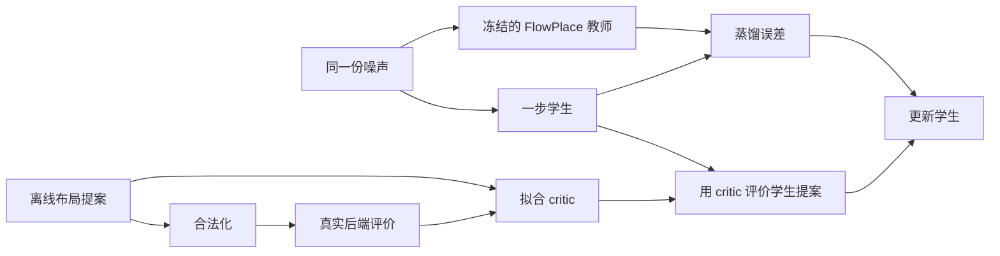

# FlowPlace × FQL 实验记录（持续更新）

当前已经跑通官方 checkpoint 的布局生成、作者发布的 OpenROAD 流程和
FQL 风格的一步策略。**尚未精确复现 Table 2，也尚未证明 FQL 改善真实 PPA。**
所有训练、生成、后端评估和数值核查均通过 FactLab Slurm。

## 实验具体做了什么

先在 bp_fe 上将完整宏布局视为一个动作：固定电路是环境，模型根据噪声
产生 11 个宏的坐标，经过官方合法化后计算奖励，随后终止。
这是单步 contextual bandit；实现迁移了 FQL 的“同噪声蒸馏 + Q 优化”，
没有将 flow 的积分步错误地当成环境动作，也没有声称复现多步 RL 的 FQL benchmark。
FlowPlace teacher 冻结，学生是同一电路上的 MLP，critic 预测原始提案经过
实际合法化后的奖励。

部署时使用学生输出加最终合法化；上图中的真实后端标签收集属于训练成本。
第一轮实际使用的是可直接计算的宏 HPWL 奖励，共 864 条记录；后续预选
96 条另取 GRT 标签，才对应图中的真实后端评价。这两个数据来源分别报告。

数据包含 288 个 teacher/noise 配对，按 family 分成 192/48/48。
每个配对产生 3 个 critic 记录，共 864 个；同源扰动始终在同一 split。
FQL、仅蒸馏和直接解析目标的学生共享初始化、训练配对和优化预算，运行
3 个训练 seed。alpha 仅根据验证集的实际合法化奖励选择。
这里的 validation/heldout 只留出了新的输入噪声，电路始终是同一个 bp_fe；
它们不代表未见过的电路或芯片设计，也不构成跨设计泛化的证据。

## 第一轮结果：仅宏 HPWL

下表是 48 个 heldout noise 的结果。学习方法先对每个 seed 求均值，再对
3 个 seed 平均；所有布局都通过独立几何检查。单位是发布缓存的坐标单位。

| 方法 | 平均宏 HPWL，越低越好 | 合法比例 |
|---|---:|---:|
| 原始 FlowPlace teacher | 81,240.7 | 100% |
| Teacher 额外做一次最终合法化 | 81,878.7 | 100% |
| 一步学生，仅蒸馏 | 76,574.6 | 100% |
| FQL 风格学生，验证集选 alpha=1 | 68,822.5 | 100% |
| 同一学生，直接使用解析 HPWL 梯度 | 44,484.2 | 100% |
| 从 teacher 开始做 100 步坐标优化 | 41,874.9 | 100% |

FQL 改善了这个代理指标，但直接优化可计算的目标更有效。bp_fe 的宏图只有
15 条 hypernet，未包含标准单元和显式固定 I/O；因此这些数值不能当成真实
布线、时序、功耗或面积的改善。坐标优化还要计入 teacher 生成及测试时
100 步优化成本，不能和一步策略只比较最终一次前向时间。

## 暴露出来的两个问题

**Q 在策略选中的动作上不够可靠。** FQL alpha=1 的三个 seed，Q 与实际
代理奖励的 Pearson R 分别为 -0.083、-0.557、-0.079。离线样本预测准确
不能保证优化 Q 后的动作仍可靠；不能用预测 Q 代替实际奖励或据此挑样本。

**Teacher 的配对映射难以用少量样本蒸馏。** 学生训练 MSE 很低，但在新
noise 上甚至不如输出训练均值的坐标预测。对前 8 个 TRAIN 点做局部诊断，
1e-5 RMS 噪声扰动在有中间硬投影时造成平均输出 MSE 0.313862，关闭投影
后为 2.68e-6；同一输入重复及缓存比对均逐位一致。这支持硬投影显著放大
小扰动这一机制，但不是全局数学不连续的证明，也不是唯一原因的证明。
关闭中间投影后的合法性、质量和多样性在以下独立诊断中实测。

已完成的 16 个 TRAIN 样本诊断显示：关闭中间硬投影的 raw 布局全部非法，
每例 28 对宏重叠；跨 noise 坐标标准差 RMS 从 0.4920 降到 0.01561。
最后合法化后 16/16 合法、14 个不同布局，平均宏 HPWL 为 41,252。
这说明输出明显收缩、最终离散合法化再引入部分差别，不能据低 HPWL
直接声称得到了更好的、多样化的 teacher。原始布局均已位于 [-1,1]，
clipping 在这里没有起作用。标准 Euler 采样另做独立实验，官方 sampler
保持不变。

标准 Euler 的有限对照已完成：同一 checkpoint、noise、20 步时间网格和
forward 精度下，相对关闭中间硬投影的 released sampler，仅将更新改为
`x_next = x + (t_next - t) * v`，raw 坐标
标准差 RMS 恢复至 0.4630，最终合法化后 16/16 合法且全部不同，宏 HPWL
为 73,195。官方 released no-hard 更新等价于
`x_next = x + t_next * (1 - t) * v`；两种步长不同。这里将标准 Euler
明确标为实验变体，不覆盖官方实现，也不把有限结果当成优越性证明。
公开训练代码采用 `x_t=(1-t)*z+t*x_data`，速度目标为 `x_data-z`，因此
显式 Euler 更新与公开速度定义一致。实现仍保留逐步 clamp、固定节点 mask
和最终合法化，尚未验证步长收敛、分布保真或完整 PPA。

随后完成了同样 192/48/48 配对、同样网络与优化预算的三 seed 蒸馏对照。
对 48 个未参与训练、但此前探索已查看的 heldout noise，原 hard teacher
的 BC 未裁剪坐标 MSE 为
0.5055–0.5469，比直接预测 TRAIN 均值还差；Euler raw teacher 的 BC
为 0.0359–0.0380，相当于其 TRAIN 均值基线误差的 16.2%–17.1%。
两种目标分布不同，因此不能只比较绝对 MSE；各自的均值基线提供参照。
简单的 `noise + mean_TRAIN(target-noise)` 在 Euler 上已有 0.04525，
说明这部分映射本来就较接近恒等变换，不能将全部收益归因于神经网络。
Euler teacher 和学生最终合法化后分别约 71,430 和 70,858 宏 HPWL；
每个方法均 48/48 合法且 48 个不同布局。这是可学习性诊断，仍非 PPA
或 FQL 优越性证据。原宏实验的 0.4872 是裁剪后的 seed0 提案误差，
与本次对应值精确一致，不应和未裁剪误差混用。
这里从 hard teacher 到 Euler raw teacher 同时改变了中间投影和更新公式，
不能将可学习性改善单独归因于其中一项；这仍是探索性诊断。

另两个固定布局控制也已完成：所有 movable 中心置零后合法化，宏 HPWL
为 41,713.52；192 个 TRAIN teacher 坐标均值合法化后为 53,505.35。
每个控制只有一个布局。零锚点已接近 no-hard 和直接坐标优化，进一步说明
低宏 HPWL 可能来自紧密摆放，不能仅凭这个数值证明生成模型有价值。

额外最终合法化也不是恒等操作：48 个 heldout teacher 布局全被移动，
平均宏 HPWL 恶化 0.791%，因此始终保留原始和再次合法化两个 teacher 对照。

## 已完成的真实后端结果

以下两例均采用作者发布的完整流程，包含详细布线。生成样例使用原始
非确定性模式的 seed300，不属于上述正式确定性数据集。

| bp_fe | 发布的 DEF | 首个生成的 DEF |
|---|---:|---:|
| 详细布线线长，百万 µm | 2.169485 | 2.152282 |
| WNS，ns | -0.573610 | -0.669114 |
| TNS，ns | -359.085 | -419.931 |
| Power，W | 0.171 | 0.175 |
| 标准单元面积，µm² | 59,268.3 | 60,285.2 |
| 剩余 DRC 数 | 1,904 | 12 |
| 流程时间，秒 | 815.84 | 461.80 |

两者都存在 DRC，不能称为干净的最终布局。作者配置将详细布线限制到第
4 次迭代，且发布配置、论文描述、可获得工具版本之间存在差异，已逐项记录。
生成样例线长略低但时序、功耗和面积更差；不能据单个样例声称整体提升。

后续独立诊断将详细布线迭代上限提高到 20，复用原生成样例的 GRT 数据库，
没有重新布局或全局布线。该例在第 9 轮达到 **0 DRC**；最终线长为
2,152,303 µm、WNS -0.669164 ns、TNS -419.959 ns，功耗和面积不变。
这个诊断耗时 357.58 秒，另计此前的 placement/GRT 成本。它说明原 12 个
DRC 可以通过继续布线消除，也说明不能将原配置的“流程结束”直接当成
“DRC 清零”。发布 DEF 的同类诊断也已完成：DRC 从 1,904 降至 192，
其中 170 个 short、19 个 metal spacing 和 3 个 cut spacing；线长从
2,169,485 增至 2,169,684 µm，WNS 不变，TNS 从 -359.085 变为
-360.475 ns，功耗与面积不变。后者耗时约 4,781 秒，同样只计恢复后的
DRT/fill/finish。两例原始及复制的 GRT 检查点均未改变。迭代上限影响
残留 DRC，但这个结果不支持用它解释论文的 TNS 和面积差距。

GRT 中间阶段另行验证：同一 released bp_fe 输入的 CTS/GRT 数据库与完整
流程对应文件逐字节一致，共享物理指标相同，耗时 141.22 秒。后续训练标签
采用这个明确标记的阶段，绝不把 GRT 线长冒充 Table 2 的详细布线线长。

六电路复跑中的两个 Ariane 电路和 bp_be 也已完成：

| 电路 | 详细布线线长，百万 µm | WNS，ns | TNS，ns | 功耗，W | 标准单元面积，µm² | DRC |
|---|---:|---:|---:|---:|---:|---:|
| ariane133 | 7.863284 | -1.17145 | -3736.33 | 0.399 | 331,564 | 1 |
| ariane136 | 8.410847 | -1.442 | -5379.48 | 0.423 | 339,460 | 14 |
| bp_be | 3.044539 | -1.2034 | -820.405 | 0.159 | 102,423 | 247 |

分别耗时 48.9、59.4 和 14.3 分钟；论文线长分别为 7.62、8.14 和 3.10 百万 µm。
它们同样属于流程复跑成功，但数值尚未重现。共同的 bp_fe 流程日志还包含
被上游流程捕获后继续执行的 `PDN-0113` 电源网络错误，因此详细布线
报告的 0 DRC 也不能当成完整电源连接检查或完整签核通过。

发布的 `swerv_wrapper` 在宏导入阶段触发 `MPL-0041`，未得到 PPA。
Slurm 作业 1784533 独立检查原始 DEF 和发布的 LEF，确认在 OpenROAD
坐标吸附之前就存在三处宏重叠；另五个发布 DEF 未发现这种重叠。
因此原表中这一行保留为失败，不使用零值或另一个布局替代。
另外单独评估官方 checkpoint 生成的合法 swerv 布局，用于判断该电路
后端流程是否可运行；它不改变发布 DEF 的复现结果。

`bp` 的原完整流程在 59 分 02 秒时被 Slurm 抢占，已完成的 GRT 检查点
得到保留。恢复作业 1785220 在新目录中继续原 cap4 的详细布线与结束阶段，
不会重新布局或改变参数。原始尝试和抢占证据仍保留，恢复阶段耗时不当成
从头跑完整流程的耗时。成本核算使用 `sacct -D` 区分同一 JobID 的不同
尝试；已核实这次被抢占的投入为 7.871111 个申请 CPU 小时，未启动的
自动重排尝试为零，两者都保留在记录中。

## 正在完成

代理到后端迁移已暴露一个真实失败：`seed_0/analytic_hpwl_alpha_1` 在
预定 noise 242 上，CTS 的 hold 修复插入 8,208 个缓冲器后触发
`RSZ-0060: Max buffer count reached`，未得到 GRT 标签。
这是固定后端配置下的实现失败，不能补成零、删除该例或放宽约束后混入原比较。
后续报告会保留全部预定案例，并对缺失成功案例的方法停止计算质量均值，
单独报告成功率与错误证据。解析宏 HPWL 更低并不能保证物理流程成功。

- bp 的发布 DEF 完整后端评估，以及单列的合法生成 swerv 布局评估。
- 预先选定的 96 个 GRT 标签，用于真实后端奖励的 critic/策略实验。
- 36 个固定候选的宏代理到真实 GRT 的迁移检查，所有模型 seed 均保留。
- 不同 sampler 与固定锚点的真实后端小样本对照。

真实后端实验还加入“直接保存训练集中已测得的最佳布局”对照。对同一固定
电路，这个简单方案可能已经很强；学习策略必须说明相对它增加了什么价值。

若 critic 的验证表现支持继续，将预先固定 alpha=1/10/100、3 个训练 seed、
4 个 validation noise：BC 加三个 FQL 配置共 48 个新后端布局。
统一选一个 alpha 后，再测固定的 4 个 heldout noise，共 24 个新布局。
每个 alpha 须在 3 个 seed × 4 个 validation noise 上全部完成后端，才参与
平均线长排名；失败配置保留完整案例，若无合格配置则不扩展 heldout。
后续 actor heldout 固定为 244–247，避开 proxy/sampler 后端探索的 240–242；
这是 actor 结果生成前按输入 ID 做的隔离修订，不是按质量挑选样本。
宏指标诊断此前仍看过全部 heldout noise，这一限制继续保留。
Teacher 和最佳训练布局只有在动作、DEF 和后端来源完全匹配时复用结果。

## 速度与成本

在同一 NVIDIA L20、4 个 CPU 线程、16 个固定 heldout noise 上，按轮换
顺序各计时 3 次，得到以下 warm latency。输入为已经位于 GPU 的 noise，
输出为 GPU 上的最终合法坐标；学生包含前向、裁剪和一次最终合法化，
teacher 原始路径已有中间硬合法化，不额外增加投影。

| 方法 | 平均生成时间，毫秒 |
|---|---:|
| 原始 FlowPlace teacher | 637.291 |
| BC，三个训练 seed 的均值 | 9.884 |
| FQL alpha=1，三个训练 seed 的均值 | 9.874 |

所有计时输出都与原正式保存的最终布局逐位相同；学生 batch1 前向存在
约 10⁻⁷ 量级差异，但未改变这些样本最终的合法化坐标。BC/FQL 的微小
延迟差别不能当作算法优势；两者加速都来自同样的一步学生结构。
以上不包含模型加载、数据传输、DEF 导出、训练或 OpenROAD，因此只能
描述布局生成阶段。后端通常耗时数分钟，整个 EDA 流程不会同比加速。
首次 teacher 调用为 2.735 秒，另行保留；它使用已有编译缓存，也不是
清空缓存后从零构建的成本。详见 `baseline/artifacts/deployed_latency_v1/`。
对同一个固定电路，直接复用训练中已测得的最佳布局不需要重新运行生成器；
其数据获取成本必须计入，但不能仅凭相对 teacher 的加速来证明学生有必要。

## 复现证据的边界

原始宏实验保留了数据/工具版本、数据哈希、参数、模型权重和日志，代码首个
本地快照为 `e4c4628`，但那一轮未在训练启动时捕获训练源码哈希。后续加入的
源码哈希记录只对后续运行生效，不能倒填成第一轮当时已经捕获的证据。
后续实现已提交为 `1b1d79d`，新的 gate、训练及候选导出会保存启动时
源码副本与哈希；报告和实验脚本后续更新仍单独保留提交记录。
此外，缓存 teacher 配对与原 FQL 持续采样新 teacher/noise 配对的训练方式
有差异；本实验的蒸馏困难不能直接推广为原 FQL 算法的普遍失败。

## 可复查材料

- `docs/evaluation_protocol.md`：split、选择规则、指标口径和公平性。
- `docs/run_ledger.md`：关键 Slurm 作业、失败与修复。
- `analysis/artifacts/bp_fe_macro_deterministic_v1/heldout/`：独立核查、表格和图。
- `runs/teacher_sensitivity_v1/`：局部敏感性完整轨迹与结果。
- `datasets/*/selection_plan.json`：看到后端结果之前锁定的候选。
- `backend/results/`：完整日志、指标、工具来源与中间文件。
- `analysis/artifacts/cost_snapshot_*/`：Slurm 申请资源的阶段性记录，包含失败成本；
  这是保留的 CPU/GPU 时间，不是实际利用率、电耗或实验总墙钟时间。
