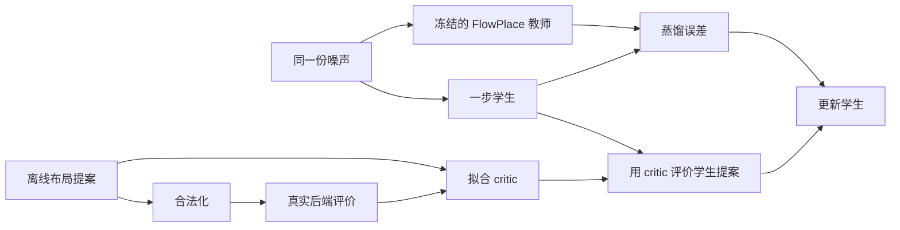

> 当前 Graph Flow-Q offline-to-online 研究见 [最新实验记录](graph_fql_offline_to_online.md) 与 [完整目标核验](completion_audit.md)。下文保留早期实验和任务快照，其中的“已完成”“尚未启动”只适用于对应历史阶段，不能作为当前目标或队列状态。

# FlowPlace × FQL 实验报告（2026-10-16/17）

本轮已经完成官方 checkpoint 的布局生成、作者发布的 OpenROAD 流程复跑和
FQL 风格的一步策略。**尚未精确复现 Table 2，也尚未证明 FQL 改善真实 PPA。**
所有训练、生成、后端评估和数值核查均通过 FactLab Slurm。

**研究判断：评估平台值得保留，当前FQL配置不值得直接扩大运行。**
宏指标收益没有转移到真实后端，而真实GRT critic未通过验证；下一步应先
验证带物理特征的后端预测是否可靠，再决定是否训练策略。Euler提供了一个
可学习性更好的实验教师，但现有后端样本显示线长与时序的取舍，不能当作
已有PPA提升。后续建议见[研究解释](research_interpretation.md)。

## 实验具体做了什么

先在 bp_fe 上将完整宏布局视为一个动作：固定电路是环境，模型根据噪声
产生 11 个宏的坐标，经过官方合法化后计算奖励，随后终止。
这是单步 contextual bandit；实现迁移了 FQL 的“同噪声蒸馏 + Q 优化”，
没有将 flow 的积分步错误地当成环境动作，也没有声称复现多步 RL 的 FQL benchmark。
FlowPlace teacher 冻结，学生是同一电路上的 MLP，critic 预测原始提案经过
实际合法化后的奖励。

部署时使用学生输出加最终合法化；上图中的真实后端标签收集属于训练成本。
第一轮实际使用的是可直接计算的宏 HPWL 奖励，共 864 条记录；后续预选
96 条另取 GRT 标签，才对应图中的真实后端评价。这两个数据来源分别报告。

数据包含 288 个 teacher/noise 配对，按 family 分成 192/48/48。
每个配对产生 3 个 critic 记录，共 864 个；同源扰动始终在同一 split。
FQL、仅蒸馏和直接解析目标的学生共享初始化、训练配对和优化预算，运行
3 个训练 seed。alpha 仅根据验证集的实际合法化奖励选择。
这里的 validation/heldout 只留出了新的输入噪声，电路始终是同一个 bp_fe；
它们不代表未见过的电路或芯片设计，也不构成跨设计泛化的证据。

## 第一轮结果：仅宏 HPWL

下表是 48 个 heldout noise 的结果。学习方法先对每个 seed 求均值，再对
3 个 seed 平均；所有布局都通过独立几何检查。单位是发布缓存的坐标单位。

| 方法 | 平均宏 HPWL，越低越好 | 合法比例 |
|---|---:|---:|
| 原始 FlowPlace teacher | 81,240.7 | 100% |
| Teacher 额外做一次最终合法化 | 81,878.7 | 100% |
| 一步学生，仅蒸馏 | 76,574.6 | 100% |
| FQL 风格学生，验证集选 alpha=1 | 68,822.5 | 100% |
| 同一学生，直接使用解析 HPWL 梯度 | 44,484.2 | 100% |
| 从 teacher 开始做 100 步坐标优化 | 41,874.9 | 100% |

FQL 改善了这个代理指标，但直接优化可计算的目标更有效。bp_fe 的宏图只有
15 条 hypernet，未包含标准单元和显式固定 I/O；因此这些数值不能当成真实
布线、时序、功耗或面积的改善。坐标优化还要计入 teacher 生成及测试时
100 步优化成本，不能和一步策略只比较最终一次前向时间。

## 暴露出来的两个问题

**Q 在策略选中的动作上不够可靠。** FQL alpha=1 的三个 seed，Q 与实际
代理奖励的 Pearson R 分别为 -0.083、-0.557、-0.079。离线样本预测准确
不能保证优化 Q 后的动作仍可靠；不能用预测 Q 代替实际奖励或据此挑样本。

**Teacher 的配对映射难以用少量样本蒸馏。** 学生训练 MSE 很低，但在新
noise 上甚至不如输出训练均值的坐标预测。对前 8 个 TRAIN 点做局部诊断，
1e-5 RMS 噪声扰动在有中间硬投影时造成平均输出 MSE 0.313862，关闭投影
后为 2.68e-6；同一输入重复及缓存比对均逐位一致。这支持硬投影显著放大
小扰动这一机制，但不是全局数学不连续的证明，也不是唯一原因的证明。
关闭中间投影后的合法性、质量和多样性在以下独立诊断中实测。

已完成的 16 个 TRAIN 样本诊断显示：关闭中间硬投影的 raw 布局全部非法，
每例 28 对宏重叠；跨 noise 坐标标准差 RMS 从 0.4920 降到 0.01561。
最后合法化后 16/16 合法、14 个不同布局，平均宏 HPWL 为 41,252。
这说明输出明显收缩、最终离散合法化再引入部分差别，不能据低 HPWL
直接声称得到了更好的、多样化的 teacher。原始布局均已位于 [-1,1]，
clipping 在这里没有起作用。标准 Euler 采样另做独立实验，官方 sampler
保持不变。

标准 Euler 的有限对照已完成：同一 checkpoint、noise、20 步时间网格和
forward 精度下，相对关闭中间硬投影的 released sampler，仅将更新改为
`x_next = x + (t_next - t) * v`，raw 坐标
标准差 RMS 恢复至 0.4630，最终合法化后 16/16 合法且全部不同，宏 HPWL
为 73,195。官方 released no-hard 更新等价于
`x_next = x + t_next * (1 - t) * v`；两种步长不同。这里将标准 Euler
明确标为实验变体，不覆盖官方实现，也不把有限结果当成优越性证明。
公开训练代码采用 `x_t=(1-t)*z+t*x_data`，速度目标为 `x_data-z`，因此
显式 Euler 更新与公开速度定义一致。实现仍保留逐步 clamp、固定节点 mask
和最终合法化，尚未验证步长收敛、分布保真或完整 PPA。

随后完成了同样 192/48/48 配对、同样网络与优化预算的三 seed 蒸馏对照。
对 48 个未参与训练、但此前探索已查看的 heldout noise，原 hard teacher
的 BC 未裁剪坐标 MSE 为
0.5055–0.5469，比直接预测 TRAIN 均值还差；Euler raw teacher 的 BC
为 0.0359–0.0380，相当于其 TRAIN 均值基线误差的 16.2%–17.1%。
两种目标分布不同，因此不能只比较绝对 MSE；各自的均值基线提供参照。
简单的 `noise + mean_TRAIN(target-noise)` 在 Euler 上已有 0.04525，
说明这部分映射本来就较接近恒等变换，不能将全部收益归因于神经网络。
Euler teacher 和学生最终合法化后分别约 71,430 和 70,858 宏 HPWL；
每个方法均 48/48 合法且 48 个不同布局。这是可学习性诊断，仍非 PPA
或 FQL 优越性证据。原宏实验的 0.4872 是裁剪后的 seed0 提案误差，
与本次对应值精确一致，不应和未裁剪误差混用。
这里从 hard teacher 到 Euler raw teacher 同时改变了中间投影和更新公式，
不能将可学习性改善单独归因于其中一项；这仍是探索性诊断。

另两个固定布局控制也已完成：所有 movable 中心置零后合法化，宏 HPWL
为 41,713.52；192 个 TRAIN teacher 坐标均值合法化后为 53,505.35。
每个控制只有一个布局。零锚点已接近 no-hard 和直接坐标优化，进一步说明
低宏 HPWL 可能来自紧密摆放，不能仅凭这个数值证明生成模型有价值。

额外最终合法化也不是恒等操作：48 个 heldout teacher 布局全被移动，
平均宏 HPWL 恶化 0.791%，因此始终保留原始和再次合法化两个 teacher 对照。

## 已完成的真实后端结果

以下两例均采用作者发布的完整流程，包含详细布线。生成样例使用原始
非确定性模式的 seed300，不属于上述正式确定性数据集。

| bp_fe | 发布的 DEF | 首个生成的 DEF |
|---|---:|---:|
| 详细布线线长，百万 µm | 2.169485 | 2.152282 |
| WNS，ns | -0.573610 | -0.669114 |
| TNS，ns | -359.085 | -419.931 |
| Power，W | 0.171 | 0.175 |
| 标准单元面积，µm² | 59,268.3 | 60,285.2 |
| 剩余 DRC 数 | 1,904 | 12 |
| 流程时间，秒 | 815.84 | 461.80 |

两者都存在 DRC，不能称为干净的最终布局。作者配置将详细布线限制到第
4 次迭代，且发布配置、论文描述、可获得工具版本之间存在差异，已逐项记录。
生成样例线长略低但时序、功耗和面积更差；不能据单个样例声称整体提升。

后续独立诊断将详细布线迭代上限提高到 20，复用原生成样例的 GRT 数据库，
没有重新布局或全局布线。该例在第 9 轮达到 **0 DRC**；最终线长为
2,152,303 µm、WNS -0.669164 ns、TNS -419.959 ns，功耗和面积不变。
这个诊断耗时 357.58 秒，另计此前的 placement/GRT 成本。它说明原 12 个
DRC 可以通过继续布线消除，也说明不能将原配置的“流程结束”直接当成
“DRC 清零”。发布 DEF 的同类诊断也已完成：DRC 从 1,904 降至 192，
其中 170 个 short、19 个 metal spacing 和 3 个 cut spacing；线长从
2,169,485 增至 2,169,684 µm，WNS 不变，TNS 从 -359.085 变为
-360.475 ns，功耗与面积不变。后者耗时约 4,781 秒，同样只计恢复后的
DRT/fill/finish。两例原始及复制的 GRT 检查点均未改变。迭代上限影响
残留 DRC，但这个结果不支持用它解释论文的 TNS 和面积差距。

GRT 中间阶段另行验证：同一 released bp_fe 输入的 CTS/GRT 数据库与完整
流程对应文件逐字节一致，共享物理指标相同，耗时 141.22 秒。后续训练标签
采用这个明确标记的阶段，绝不把 GRT 线长冒充 Table 2 的详细布线线长。

六电路发布DEF复跑最终有5个完成完整流程，1个因原始宏重叠失败。
其中另外四个电路的结果如下；bp_fe见上表，swerv失败见下文：

| 电路 | 详细布线线长，百万 µm | WNS，ns | TNS，ns | 功耗，W | 标准单元面积，µm² | DRC |
|---|---:|---:|---:|---:|---:|---:|
| ariane133 | 7.863284 | -1.17145 | -3736.33 | 0.399 | 331,564 | 1 |
| ariane136 | 8.410847 | -1.442 | -5379.48 | 0.423 | 339,460 | 14 |
| bp（抢占后恢复） | 9.983616 | -4.53567 | -1732.43 | 0.596 | 471,521 | 45 |
| bp_be | 3.044539 | -1.2034 | -820.405 | 0.159 | 102,423 | 247 |

两个Ariane和bp_be分别耗时48.9、59.4和14.3分钟；论文线长分别为
7.62、8.14和3.10百万µm。bp的论文线长为10.03百万µm。
它们同样属于流程复跑成功，但数值尚未重现。共同的 bp_fe 流程日志还包含
被上游流程捕获后继续执行的 `PDN-0113` 电源网络错误，因此详细布线
报告的 0 DRC 也不能当成完整电源连接检查或完整签核通过。

发布的 `swerv_wrapper` 在宏导入阶段触发 `MPL-0041`，未得到 PPA。
Slurm 作业 1784533 独立检查原始 DEF 和发布的 LEF，确认在 OpenROAD
坐标吸附之前就存在三处宏重叠；另五个发布 DEF 未发现这种重叠。
因此原表中这一行保留为失败，不使用零值或另一个布局替代。
另外单独评估官方 checkpoint 生成的合法 swerv 布局：固定确定性seed300
在同一作者配置下完成完整流程，rWL为4.163184百万µm、WNS为
-0.588714ns、TNS为-681.557ns、功耗0.249W、标准单元面积182038µm²，
仍有7282个DRC，耗时3146.42秒。原始报告核查通过。这说明该电路的
后端流程可运行，但不表示签核通过，也不替换发布DEF的失败行。

`bp` 的原完整流程在 59 分 02 秒时被 Slurm 抢占，已完成的 GRT 检查点
得到保留。恢复作业1785220已在新目录中完成原cap4的详细布线与结束阶段，
未重新布局或改变物理参数；原始报告核查、5个检查点及执行文件检查通过。
恢复阶段耗时2302.36秒，仅计DRT/fill/finish。原始尝试和抢占证据仍保留，
恢复阶段耗时不当成
从头跑完整流程的耗时。成本核算使用 `sacct -D` 区分同一 JobID 的不同
尝试；已核实这次被抢占的投入为 7.871111 个申请 CPU 小时，未启动的
自动重排尝试为零，两者都保留在记录中。

完整六电路对照见[逐项对照表](../analysis/artifacts/table2_released_v1/comparison.md)。
汇总作业1785253以退出码1明确表示只完成5/6行；这是保留已确认的swerv
失败，不是仍有任务排队，也不通过删去失败行计算全表平均值。Table2数值
仍未精确复现，尤其部分TNS和面积差距明显；不能仅凭相近线长宣称复现成功。

## 宏代理优化能否转移到真实后端

36 个预先固定的候选已经全部结束，35 个成功、1 个明确物理失败。
它们来自宏指标验证集选择后的方法，使用同一电路的 noise240–242；
没有根据这些后端结果重新选择超参数。以下只报告 GRT 中间阶段，
不是详细布线或签核结果。学习方法先对每个 seed 的3个 noise求均值，
再对3个 seed平均；teacher和坐标优化各只有一组3个 noise。

| 方法 | GRT平均线长，百万 µm | 后端成功案例 |
|---|---:|---:|
| 原始 teacher | 2.395844 | 3/3 |
| Teacher再做一次最终合法化 | 2.311649 | 3/3 |
| 仅蒸馏学生 BC | 2.318026 | 9/9 |
| 宏奖励 FQL，alpha=1 | 2.411152 | 9/9 |
| 直接解析 HPWL 学生，alpha=1 | 不计算：存在失败 | 8/9 |
| Teacher起点的100步坐标优化 | 2.060663 | 3/3 |

**宏奖励 FQL 的优势没有转移到这个后端小样本。** 它的三个 seed平均
WNS分别约-0.516、-0.544、-0.550ns，也都比对应BC的
-0.405、-0.357、-0.403ns更差。坐标优化的GRT线长更低，但平均WNS
为-0.601935ns，原始teacher为-0.370515ns，仍有质量取舍。
不能把线长改善概括成所有PPA改善，也不能把单电路、3个noise当作
跨设计或统计显著的证明。

失败案例是 `seed_0/analytic_hpwl_alpha_1` 在
预定 noise 242 上，CTS 的 hold 修复插入 8,208 个缓冲器后触发
`RSZ-0060: Max buffer count reached`，未得到 GRT 标签。
这是固定后端配置下的实现失败，不能补成零、删除该例或放宽约束后混入原比较。
报告保留全部预定案例；该seed及整个解析学生配置均不计算质量均值，
单独报告成功率与错误证据。解析宏 HPWL 更低并不能保证物理流程成功。
原始数据和图位于 `analysis/artifacts/proxy_transfer_grt_v1/`；
35个成功结果的物理流程版本一致，失败之外没有未解决的解析或来源错误。

## 直接使用真实 GRT 奖励：critic 验证未通过

预定的96个标签已经全部完成来源与数值核查。其中64个训练布局来自32个
noise家族，16个验证布局来自8个家族；另外16个heldout标签未用于本次
gate。固定64×64网络、1000步、3个seed，在训练集拟合较好，在验证集
却都输给“始终预测训练均值”的常数基线。

| 方法 | 训练MAE | 验证MAE | 验证Spearman |
|---|---:|---:|---:|
| 训练均值常数 | 0.02682 | **0.03913** | 无定义 |
| Critic seed0 | 0.01399 | 0.06368 | -0.0118 |
| Critic seed1 | 0.01400 | 0.07370 | -0.1676 |
| Critic seed2 | 0.01252 | 0.04507 | +0.1559 |

这里的MAE以训练平均线长2341121.25µm归一化，**不是MAPE**。
预测并非塌缩为常数：验证预测标准差是真实标签的0.79–1.48倍，
但变化方向不可靠，并且平均偏乐观。预定继续条件是至少2/3个seed同时
改善常数MAE并获得正排序相关性，实际为0/3。因此本轮**不启动**原计划的
GRT actor训练及48个validation、24个heldout后端任务；不是运行后挑掉
坏结果，也不是证明FQL整体无效。它只说明当前数据覆盖、输入表示及
网络设置不足以可靠指导新动作。后续应先改善并重新验证critic，保留
新的最终测试数据，而不是反复挑选这8个验证家族上最好的设置。

同时保存了64个TRAIN布局中真实GRT线长最低的固定布局：源row12、
线长2159262µm、WNS -0.379821ns、TNS -153.036ns。选择只用TRAIN，
这是一个已有测量，不复制成多个noise的独立重复；其最低获取预算为
32个teacher生成及64个后端标签，不能把它当作免费基线。对同一固定电路，
这个布局可以直接复用；学习策略还需要证明相对它增加了什么价值。
完整证据位于 `runs/bp_fe_grt_gate_v1/`。

原条件扩展的候选导出、合法化、验证选择、失败保留及heldout封存代码已
实现并通过软件检查，但没有真实运行结果。预声明的heldout为244–247，
避开proxy/sampler后端探索的240–242；宏指标诊断仍看过全部heldout
noise，不能宣称完全未接触这些输入。

## 不同采样方法的真实后端对照

预定的11个候选现已全部有明确结局：10个成功、1个固定零锚点在CTS
失败。一个no-hard候选曾被Slurm抢占，保留原尝试后，以相同DEF和
物理配置重试成功；独立校验通过，仍只算原来的一个候选。

| 生成方法 | GRT平均线长，百万µm | 平均WNS，ns | 成功案例 |
|---|---:|---:|---:|
| 原始teacher | 2.395844 | -0.370515 | 3/3 |
| Released no-hard + 最终合法化 | 2.398176 | -0.462303 | 3/3 |
| Experimental Euler + 最终合法化 | 2.204934 | -0.443677 | 3/3 |
| 固定TRAIN均值 + 合法化 | 2.276112 | -0.483506 | 1/1 |
| 固定零锚点 + 合法化 | 无结果 | 无结果 | 0/1 |

Euler的线长在这3个配对样本上平均降低约7.99%，但3个样本的WNS都
变差。因此它提供了一个值得继续核查的线长/时序取舍，尚不能称为PPA
全面改善。Released no-hard虽然宏HPWL很低，真实GRT线长却没有改善。
固定零锚点在hold修复插入8221个缓冲器后触发RSZ-0060，说明紧密摆放
并不保证后端可实现。两个固定控制各只有一次测量，不是3次noise重复。
本表仅为单电路的小样本探索，也没有测Euler学生的真实后端表现。

原始请求、完整11例分母、物理失败和基础设施重试记录见
`analysis/artifacts/sampler_transfer_grt_recovered_v1/`。

## 速度与成本

在同一 NVIDIA L20、4 个 CPU 线程、16 个固定 heldout noise 上，按轮换
顺序各计时 3 次，得到以下 warm latency。输入为已经位于 GPU 的 noise，
输出为 GPU 上的最终合法坐标；学生包含前向、裁剪和一次最终合法化，
teacher 原始路径已有中间硬合法化，不额外增加投影。

| 方法 | 平均生成时间，毫秒 |
|---|---:|
| 原始 FlowPlace teacher | 637.291 |
| BC，三个训练 seed 的均值 | 9.884 |
| FQL alpha=1，三个训练 seed 的均值 | 9.874 |

所有计时输出都与原正式保存的最终布局逐位相同；学生 batch1 前向存在
约 10⁻⁷ 量级差异，但未改变这些样本最终的合法化坐标。BC/FQL 的微小
延迟差别不能当作算法优势；两者加速都来自同样的一步学生结构。
以上不包含模型加载、数据传输、DEF 导出、训练或 OpenROAD，因此只能
描述布局生成阶段。后端通常耗时数分钟，整个 EDA 流程不会同比加速。
首次 teacher 调用为 2.735 秒，另行保留；它使用已有编译缓存，也不是
清空缓存后从零构建的成本。详见 `baseline/artifacts/deployed_latency_v1/`。
对同一个固定电路，直接复用训练中已测得的最佳布局不需要重新运行生成器；
其数据获取成本必须计入，但不能仅凭相对 teacher 的加速来证明学生有必要。

最终Slurm快照1785509记录本实验约**111.19个CPU小时、0.2592个GPU小时**。
这是申请并占用的资源时间，包含安装、失败、抢占及恢复，不是实际利用率、
电耗或总墙钟时长。各次抢占和恢复分别计入，未启动的自动重排计零；
快照时唯一仍显示RUNNING的是采集作业自己，随后也以0:0结束。
明细见 `analysis/artifacts/cost_final_v1/`。

## 复现证据的边界

原始宏实验保留了数据/工具版本、数据哈希、参数、模型权重和日志，代码首个
本地快照为 `e4c4628`，但那一轮未在训练启动时捕获训练源码哈希。后续加入的
源码哈希记录只对后续运行生效，不能倒填成第一轮当时已经捕获的证据。
后续实现已提交为 `1b1d79d`，新的 gate、训练及候选导出会保存启动时
源码副本与哈希；报告和实验脚本后续更新仍单独保留提交记录。
此外，缓存 teacher 配对与原 FQL 持续采样新 teacher/noise 配对的训练方式
有差异；本实验的蒸馏困难不能直接推广为原 FQL 算法的普遍失败。

## 可复查材料

- `docs/evaluation_protocol.md`：split、选择规则、指标口径和公平性。
- `docs/run_ledger.md`：关键 Slurm 作业、失败与修复。
- `analysis/artifacts/bp_fe_macro_deterministic_v1/heldout/`：独立核查、表格和图。
- `runs/teacher_sensitivity_v1/`：局部敏感性完整轨迹与结果。
- `datasets/*/selection_plan.json`：看到后端结果之前锁定的候选。
- `backend/results/`：完整日志、指标、工具来源与中间文件。
- `analysis/artifacts/cost_final_v1/`：最终Slurm申请资源快照，包含失败成本；
  这是保留的 CPU/GPU 时间，不是实际利用率、电耗或实验总墙钟时间。
- `docs/completion_audit.md`：原始目标逐项完成状态及证据入口。

## 2026-10-17 晚：重新学习行为 flow 的接入试验

用户暂停 Table 2 后授权仔细尝试 FQL。这里是后续新实验，与前文已结束的
缓存 teacher 蒸馏分开记录；原先负面结果和失败均保留。

这次补齐了原 FQL 中的重要组成：先用离线 raw proposal 做 flow matching
训练行为 flow，再不断采样新的 Gaussian noise，把同噪声对应的行为 flow
输出蒸馏给一步策略。策略同时接受 Q 梯度，梯度不穿过多步积分或离散合法化。
仍是单电路 bp_fe、一次动作生成全部坐标的终止任务，网络为 MLP；不声称
已把原版 FlowPlace 的图网络完整替换，也不测试跨电路泛化或多步 Bellman 学习。

3 个种子的训练 1788584 已成功。新 BC 学生的验证坐标 MSE 分别为
0.00574、0.00860、0.00525。与旧硬投影教师的蒸馏相比，这个目标更容易学，
但教师、先验和训练流程同时改变，不能把差异单独归因于某一项改动。
全部新宏候选均通过独立几何检查。32 个同电路 validation noises 上，
3-seed mean macro HPWL 如下；它们是宏代理目标，不是布线 PPA。

| 方法 | 宏 HPWL，缓存坐标单位 |
|---|---:|
| 原始 FlowPlace cached teacher，一份 32-noise 参考 | 80,861.57 |
| 新 learned behavior flow，3-seed mean | 76,006.65 |
| 一步 BC，3-seed mean | 76,048.26 |
| FQL alpha=1，3-seed mean | 67,375.81 |
| FQL alpha=10，3-seed mean | 74,987.85 |
| FQL alpha=100，3-seed mean | 75,959.02 |

强 Q 引导的宏 critic 在策略选择分布上仍有外推问题，例如部分 seed 训练时
预测出正 reward，而实际 reward 定义始终非正。因此这里的代理目标下降
不能作为可靠后端优化证据。

另用已有 96 个真实 GRT 标签诊断 critic，只在 64 个 TRAIN 布局、32 个
噪声家族上做分组五折 CV 选 ridge 惩罚，在原 16 个 validation 布局上报告
结果；没有读取 heldout 预测，也没有把验证数据重新称为独立最终测试。
raw physical 的 17 个特征含 HPWL、面积加权几何、边界/重叠和软密度。
验证 reward MAE 为 0.025367，对照 TRAIN 常数为 0.039135，降低约 35.2%；
Spearman 为 0.7265，但 TRAIN CV Spearman 仅 0.3200，信号仍有限。
executed-layout 表示虽也报告，不能对离散合法化直接求梯度。
这些指标衡量布线线长 reward 的预测，不是功耗预测，也不是实际线长降幅。

真实后端对照固定 3 seeds × 2 noises（192/193）× 两方法，共 12 个候选。
两方法从相同 BC 检查点出发，均继续训练 1500 步；FQL 使用固定 alpha=1，
critic 和行为 flow 冻结。不按 Q 选样，不用真实结果更改 alpha/seed/布局。
12/12 DEF 导出都通过独立宏几何和舍入检查；这不保证后续物理流程成功。

<!-- fresh-physical-result: completed -->
**真实 GRT 已全部完成并复查：12/12 成功，无物理失败，1 次同输入抢占恢复。**
原始报告重读确认 12 例共用同一 physical-flow revision；Q 训练与新评估的工具、
设计约束、工艺配置、线程数和报告方式一致。以下为完整预定样本，未挑 seed。

| 方法 | 实测布局数 | 平均 GRT rWL，µm | 平均 WNS，ns | 平均 TNS，ns |
|---|---:|---:|---:|---:|
| 原 FlowPlace + 数据采集时再合法化，已有同两 noise 参考 | 2 | 2,430,166.00 | -0.429225 | -238.2330 |
| 新行为 flow 的一步 BC continuation，3 seeds × 2 noises | 6 | 2,307,378.50 | -0.355149 | -196.9770 |
| 同起点、同预算，加真实 GRT Q 引导 | 6 | 2,286,268.67 | -0.371951 | -163.7235 |
| 已有 TRAIN 64 布局中最小 rWL 的固定布局 | 1 | 2,159,262.00 | -0.379821 | -153.0360 |

两份 teacher 参考只计两次测量，没有复制成六个独立重复。它包含数据采集时
追加的最终合法化，与原始 FlowPlace 原样输出、Table 2 released DEF 结果
区分。固定最优布局只计一次，选择成本为 64 个 TRAIN 后端标签及 32 个父
teacher noise 家族；新策略另外用了 192 份 TRAIN teacher/noise 数据及训练。

Q 引导相对匹配 BC 的平均 rWL 降约 **0.915%**；逐配对改善比例的平均为
0.857%，两者定义不同。6 对中 4 对线长改善，2 对恶化；只有 2 对 WNS 改善。
逐 seed 的平均线长分别为：BC 2,269,410 / 2,369,662 / 2,283,063.5；
FQL 2,318,702.5 / 2,292,641 / 2,247,462.5 µm。因此收益不稳定：seed0
反而更差。平均 WNS 变差，TNS 改善，功耗略升（0.168513→0.169021 W），
标准单元面积几乎相同（60,312.63→60,312.23 µm²）。不能写成 PPA 全面提升。
相对两份 teacher 参考的差异也不能全归于 Q：BC 已有明显变化，而 Q 的
额外增益很小。六个 FQL 候选的最低 rWL 为 2,185,930 µm，仍未超过 TRAIN
固定最优布局；单电路学习策略优于简单复用的价值尚未建立。

独立 NumPy 特征实现重算了 actor Q，并验证与保存的 Torch Q 一致。Q 对
6 个 FQL 候选的 reward MAE 为 **0.038308**，Spearman **-0.02857**；对
6 个 BC 候选的 MAE 为 0.023153，Spearman -0.42857。与缓存 validation
上的 MAE 0.025367、Spearman 0.7265 不同，策略实际选择的输入上排序仍
不可靠。样本很少、共享两个噪声家族，这些相关性只作诊断；不能断言所有
设计上的 Q 都失效。标准化特征距离也仅为描述，不能当作校准的不确定性。

结论：新的行为 flow 与 fresh-noise 一步蒸馏机制可以跑通；当前小样本
Q 引导有有限平均线长收益，但不能建立稳健的后端优势。下一步优先研究
物理先验与保守 Q、策略分布上的校准，再考虑图网络、多电路和新的封存
测试。没有启动额外训练、后端扩张或 heldout；Table 2 仍保持暂停。

最终原始报告复查和抢占绑定位于候选目录 `backend_report_v2/`。其最终
aggregate 阶段的 1788998 因保留字段冲突退出：探索性计划误用保留键
`physical_failure_policy` 存储文字，严格汇总器要求该键是另一套 48-case
实验的策略哈希绑定。失败记录原样保留，没有放宽汇总检查。
兼容汇总 **1789015 COMPLETED 0:0** 在独立 `backend_report_v3/` 中保留
并绑定原计划，只把描述键重命名为 `physical_failure_note`，所有科学字段
逐项还原相等后走严格 12 例全成功审计。1789016/1789017/1789018 的完整
配对报告、Q 校准和已有 teacher 参考比较均以 0:0 完成。此前依赖失败汇总
而未启动的 1788999/1789003/1789014 已取消，不留下不可满足的后台任务。

最终证据：`backend_report_v3/aggregate/report.json`、
`backend_report_v3/compatibility_proof.json`、
`/fact_data/bohanli/flowplace_fql/fresh_flow_full_summary_v1/summary.json`、
`/fact_data/bohanli/flowplace_fql/physical_selection_diagnostic_v1/report.json`、
`/fact_data/bohanli/flowplace_fql/fresh_reference_comparison_v1/report.json`。

恢复记录：1788588 因容器配额根目录挂载错误，在创建结果前退出；修复绑定
后相同候选由 1788685 执行。1788685_0 被 Slurm PREEMPTED，原 manifest/log
保留，仅补跑同输入 1788997；它不是新候选，也不是为了更好的质量重跑。
原始报告重读、恢复绑定、完整 12 分母汇总为 1788998。

证据入口：`fql/fresh_flow_plan_v2.json`、`fql/physical_actor_plan_v1.json`、
`fql/physical_preemption_plan_v1.json`；训练结果位于
`/fact_data/bohanli/flowplace_fql/fresh_flow_pilot_1788584/`，物理 critic 位于
`/fact_data/bohanli/flowplace_fql/physical_critic_1788582/`，12 个候选位于
`/fact_data/bohanli/flowplace_fql_backend/fql_physical_actor_1788587/`。
最终配对报告目标为 `/fact_data/bohanli/flowplace_fql/fresh_flow_full_summary_v1/`，
策略所选布局的 Q 校准目标为
`/fact_data/bohanli/flowplace_fql/physical_selection_diagnostic_v1/`。
